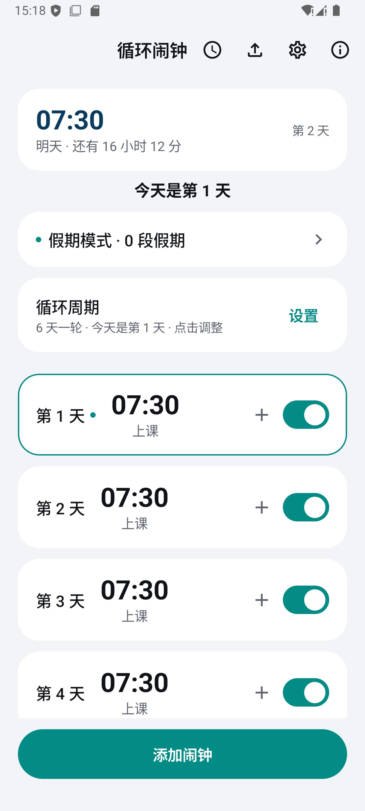
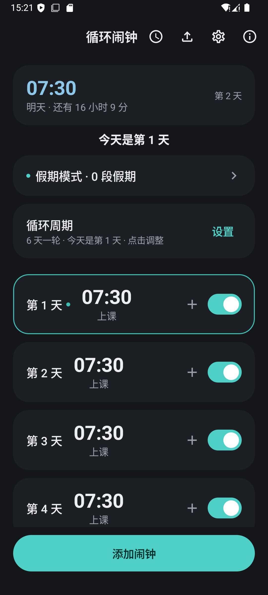
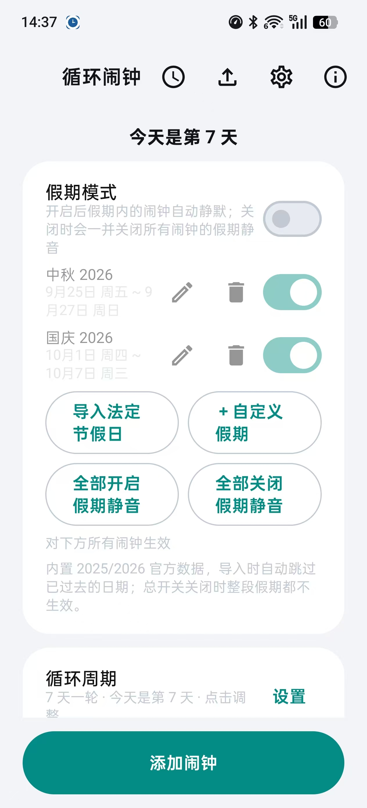
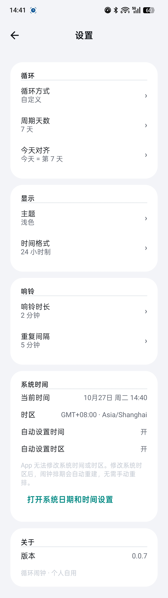

# 循环闹钟（CycleAlarm）

一个为"六天一轮、每天不同上课时间"这类作息设计的 Android 闹钟应用。

> 仓库地址：<https://github.com/PANZER-VIII-MAUS/CycleAlarm>

[](https://github.com/PANZER-VIII-MAUS/CycleAlarm/actions/workflows/android.yml)

- 支持三种循环方式：每天（1 天）、每周（周一至周日）、自定义 N 天；周期内每天独立设置时间 / 启用状态 / 备注
- 每天可以挂一个「安排」（上课 / 自习 / 休息，类型可自定义增删改），按安排自动生成或撤销当天闹钟
- 支持「从课表 / 排班表导入」：Excel(.xlsx) 与 CSV，导入前有可编辑预览
- 支持"假期模式"：多段假期 + 总开关，可一键导入中国法定节假日，假期结束自动恢复
- Kotlin + Jetpack Compose 界面，Room 持久化，AlarmManager 精确排期，WorkManager 每日兜底重排 + 前台服务响铃
- 适配 ColorOS / HyperOS 等国产 ROM：自启动、电池优化、后台弹出界面等权限引导，`setAlarmClock()` 高优先级排期，常驻前台服务降低被杀概率

> 兼容性：最低 Android 8.0（minSdk 26）；精确闹钟、通知权限、全屏提醒等按 Android 12 / 13 / 14 的行为分别做了处理。
> 目前的真机验证环境是 OPPO Find X7（ColorOS / Android 14），其它机型尚未逐一实测——遇到问题欢迎提 Issue。

<p align="center">
  
  
  
</p>

<details>
<summary>更多截图：设置页</summary>



</details>

## 下载安装

正式 APK 请从项目的 **GitHub Releases** 页面下载并侧载安装。覆盖安装新版本时，必须使用与原安装包相同的签名；签名不一致时，Android 会拒绝覆盖安装，只能卸载旧版，卸载会清除应用数据。

## 隐私

本应用不申请 `INTERNET` 权限、不联网、不收集任何数据，也不包含任何第三方统计 SDK。闹钟、循环安排、假期和导入结果均保存在设备本地。

## 权限说明

| 权限 | 用途 |
|---|---|
| `SCHEDULE_EXACT_ALARM` | 在支持的 Android 版本上申请精确闹钟能力，确保闹钟按设定时间触发。 |
| `USE_EXACT_ALARM` | 供符合闹钟类应用条件的版本使用精确闹钟；应用仍会处理权限不可用时的降级排期。 |
| `POST_NOTIFICATIONS` | 在 Android 13 及以上显示闹钟、前台服务和权限状态通知。 |
| `RECEIVE_BOOT_COMPLETED` | 设备重启后接收系统广播并重建闹钟排期。 |
| `FOREGROUND_SERVICE` + `FOREGROUND_SERVICE_SPECIAL_USE` | 启动带持续通知的前台服务，降低长期后台运行和响铃服务被系统回收的概率。 |
| `USE_FULL_SCREEN_INTENT` | 锁屏或屏幕熄灭时展示全屏响铃界面，方便快速停止或稍后提醒。 |
| `REQUEST_IGNORE_BATTERY_OPTIMIZATIONS` | 引导用户在系统设置中将应用加入电池优化白名单，减少后台排期被限制。 |
| `VIBRATE` | 闹钟响铃时提供振动提醒。 |
| `WAKE_LOCK` | 响铃期间短时保持 CPU 工作，避免屏幕唤醒后铃声或振动立即中断。 |
| `SYSTEM_ALERT_WINDOW` | 仅用于检测和引导用户打开悬浮窗相关系统权限；应用核心闹钟功能不依赖悬浮窗覆盖其他应用。 |
| `ACCESS_NETWORK_STATE` | 由 WorkManager 引入（用于判断调度约束）；应用自身不联网、不上传任何数据。 |

---

## 更新日志

### 0.2.4（2026-10-29）

- 撤销链重构：导入快照保留 24 小时（离开导入页不再删除）；快照损坏时自动清除并提示，不再永久卡死撤销
- 撤销只取消「导入后新增」的闹钟排期，不再连带清掉其它闹钟的稍后提醒
- 数据库 v8（纯数据回填，不改表结构）：恢复历史上被「关闭假期模式」抹掉的安排闹钟假期静音；老库升级后 `plansSeeded` 置 1，杜绝误注入默认计划
- 默认计划注入上限收敛到 6 天；新增「新装标记」，用户把闹钟删光也不会被当成新装重新注入
- 权限引导改为真实状态：电池优化 / 响铃通知渠道 / 全屏提醒（Android 14+）可正确显示已授权，返回页面自动刷新
- 自启动跳转不再用 `resolveActivity` 预检（Android 11+ 会误判），失败时退回应用详情并提示手动路径；补充 `<queries>` 与 ColorOS 12+ / 荣耀组件
- 下次响铃卡：超过 48 小时按「N 天」显示；每周模式来源标签显示「周X」、每天模式显示「每天」；12 小时制补上午/下午

### 0.2.3（2026-10-29）

- 排期对账：重排后与系统 `nextAlarmClock` 比对，不一致立即重建并记录
- 漏响检测：设备关机 / 被强杀跨过闹钟时间后，会收到「错过闹钟」提醒（走独立通知渠道）
- 兜底通知改为独立渠道并检查通知权限，带「立即重排」按钮；排期失败也会通知
- 稍后提醒：响铃服务成功后才消费记录，停止时同步取消排期，恢复前校验原闹钟仍在
- 重排加 8 秒超时保护，协程取消不再被吞
- `requestCode` 命名空间加显式断言；补 `AlarmScheduler` 多日循环测试

### 0.2.2（2026-10-29）

- 修复响铃链路的崩溃风险：前台服务被 ROM 拒绝时不再崩溃，降级为普通通知并继续响铃
- 「一直响」加 15 分钟硬上限：通知被拒时也不会无限响到只能强杀进程
- 试听与真实响铃隔离：试听时点「稍后 / 停止」不再污染真实 snooze 记录
- 响铃页支持返回键停止、屏幕常亮、跟随服务退出；连续两个闹钟不再串数据
- 点卡片可直接换「安排」类型，不必先删除变「未安排」再重选
- 周课表导入：写入层加「已确认」门禁；切每周时同步清理 `day_plans`，杜绝幽灵闹钟

### 0.2.1（2026-10-27）

- 提高正文说明文字对比度，禁用态改用明确文字表达。
- 12/24 小时制覆盖类型管理、导入预览与平台时间选择器。
- 补齐深色启动主题和深色平台时间选择器。
- 对话框与导入编辑状态支持旋转恢复，Flow 改为生命周期感知收集。
- 补齐 TalkBack 按钮角色、开关状态和日卡语义。
- 手动闹钟、假期、按日期闹钟支持 5 秒撤销。

### 0.2.0（2026-10-27）

- 首页新增「下次响铃」卡。
- 今天卡片高亮，并支持跨天自动刷新。
- 假期卡默认折叠，减少首屏占用。

### 0.1.0（2026-10-27）

- 导入改为事务化写入，并持久化最近一次导入快照。
- snooze 落库，重启设备后可重建未到期的稍后提醒。
- 修复假期静音标记被总开关永久清除的问题。
- 编辑由安排生成的闹钟后会脱离自动同步。
- 数据库升级到 v7，新增 snoozes 与 import_snapshots 表。

### 0.0.8（2026-10-27）

- 响铃失败不再打断后续排期。
- 升级不再清空既有闹钟。
- 状态栏时钟图标进入主界面。

### 0.0.7（2026-10-27）

- 设置从弹窗改为**独立页面**（`ui/settings/`）：循环 / 显示 / 响铃 / 系统时间 / 关于五块卡片，逐项点选即时生效；
  仅「周期天数」「今天对齐」需要点确定，缩短天数会二次确认。
- 12 小时制卡片显示改为 **`7:30` + 副标题「上午 · 上课」**，中间列恢复固定 80dp，所有行中心线对齐。
- 导入页文案：图片识别改为「图片识别暂不支持」，并加一行引导说明。
- 设置页新增「关于」显示版本号（读取 PackageManager，不依赖 BuildConfig）。

### 0.0.6（2026-10-27，正式版）

- 「添加闹钟」改为真正新增一条手动闹钟（选天后直接进入编辑，默认 07:00；新建时不显示「删除」）。
- 设置新增「响铃时长」（30 秒 / 1 / 2 / 3 / 5 / 10 分钟 / 一直响）与「重复间隔」（5–30 分钟），选择即生效。
- 设置新增「时间显示方式」：24 小时制 / 12 小时制（主界面卡片、按日期闹钟、响铃通知、时间选择器全部跟随）。
- 设置新增「系统时间」只读区：当前时间、时区、自动设置时间/时区状态，并可跳转系统日期时间设置（App 不修改系统时间）。
- 卡片细节：时间与副标题居中并统一中轴线；非响铃状态显示「未安排 / 休息 / 点此设置」；开关语义改为「今天会不会响」。
- 「今天是第 N 天」固定显示在列表上方（不随滚动消失），18sp Bold 居中。

### 0.0.5（2026-10-27）

- 按设计稿统一视觉：浅灰蓝底 + 白色 24dp 圆角卡片 + 深青绿主色 `#038C85` + 超大时间数字 + 底部胶囊「添加闹钟」。
- 新增 `ui/theme/Color.kt`（浅色 9 + 深色 9 个令牌 + ExtraColors）、`ui/theme/Type.kt`（全局字号）、`Shapes`（卡片 24dp / 对话框 28dp）。
- 主界面改为「每天一张卡」：第 N 天 / 30sp 时间 / 副标题（安排名或休息）/ 右侧开关；手动闹钟作为卡片内次级条目；未安排显示「—」。
- 时间编辑对话框改为自建 `ScrimDialog` + Material3 `TimePicker` + 54sp Navy 大字 + 胶囊「保存」+ 红色「删除」。
- 系统栏：`MainActivity` / `ImportActivity` 各 1 行 `enableEdgeToEdge()`；状态栏图标深浅由 `CycleAlarmTheme` 按 App 主题设置。
- 响铃页保持深色底，仅把按钮改为胶囊 + 主色/危险色。

### 0.0.4（2026-10-27）

- 新增「循环安排」：每个周期日挂一个安排类型（上课 / 自习 / 休息），类型可自定义增删改、调顺序。
- 改安排自动增删该天闹钟：上课默认 07:30、自习默认 08:30、休息不响铃；同类型可被多天使用。
- 数据库升到 v6：新增 `activity_types`、`day_plans` 两张表和 `alarms.planGenerated`、`settings.plansSeeded` 两列，
  全部走 `MIGRATION_5_6`，无破坏性迁移。
- 首次升级按新规则重建：第 1..N-1 天 = 上课 07:30，第 N 天 = 休息（`date_alarms` 按日期闹钟保留）。

### 0.0.3（2026-10-26）

- 新增「从课表 / 排班表导入闹钟」：支持 Excel(.xlsx) 与 CSV，导入前有可编辑预览。
- 支持两种表格形态：**周课表（星期 × 时间）** 与 **按日期排班表（日期 + 课程）**。
- 新增 `date_alarms` 表（Room v5），并补充 **4→5 真迁移**，升级不再清空已有闹钟。
- 按日期一次性闹钟同样支持假期静音、单条启停、编辑与删除。

### 0.0.2（2026-08-20）

- 厂商识别 + 权限引导升级：自动识别 ColorOS / HyperOS / OriginOS / MagicOS 等 ROM，
  在首次引导页显示对应的自启动、电池耗电、后台弹出界面等设置指引。

### 1.0.1（2026-08-19，早期内部测试版；版本号后统一为 0.0.x）

1. 发现了些已知的问题，修复了些已知的 bug。
2. 探索了宇宙的边界。

实际改动：修复 Android 14/15 精确闹钟权限被拒导致的启动闪退（`USE_EXACT_ALARM` + 排期降级兜底）；
假期静音开关显示为"假期静音：开 / 关"；新增主题设置（跟随系统 / 浅色 / 深色）。

---

## 功能与界面

- 循环方式确定后**天数固定**，只能在第 1..N 天（或周一..周日）里添加闹钟，不能随意扩展天数
- 主界面「每天一张卡」：左侧第 N 天，中间 30sp 时间 + 副标题（安排名 / 休息 / 未安排），右侧开关决定"今天会不会响"
- 每个周期日挂一个「安排」（上课 · 07:30 / 休息 / 未安排）；点卡片改这一天的安排时间，点卡片内「+」新增一条独立手动闹钟
- 手动闹钟作为卡片内次级条目，可单独编辑时间 / 备注 / 启停 / 假期静音，也可删除
- 底部固定胶囊「添加闹钟」：选任意一天后新建一条手动闹钟（默认 07:00），与安排互不影响
- 时间选择：安排时间用 Material3 `TimePicker` 表盘；手动闹钟沿用系统时间选择器
- 顶部固定一行「今天是第 N 天」（每周模式为「今天是 周X」），不随列表滚动
- 右上角「设置」是独立页面：循环（方式 / 天数 / 今天对齐）、显示（主题 / 12 或 24 小时制）、
  响铃（响铃时长 / 重复间隔）、系统时间（只读 + 跳转系统设置）、关于
- 假期卡片：假期模式总开关；「导入法定节假日」一键加入内置的官方放假安排（自动跳过已过去的日期）；
  「＋自定义假期」添加任意区间；每段假期可单独开关、编辑、删除
- 首次启动按「第 1..N-1 天 = 上课 07:30、第 N 天 = 休息」初始化安排，并自动导入还没过去的法定节假日
- 右上角「从课表导入」：选 Excel/CSV → 解析 → 预览修正 → 写入闹钟；支持周课表与按日期排班表
- 顶栏「安排」图标打开类型管理：增删改类型、调顺序、显示使用天数；改时间会询问是否同步已安排的日子
- 首次启动自动弹出关键权限引导；右上角"i"可随时重新打开

## 技术栈与版本

| 组件 | 版本 |
|---|---|
| Kotlin / Compose | 1.9.22 / BOM 2024.06.00（Compose 1.6.8 + Material 3，编译器 1.5.10） |
| AGP / Gradle | 8.2.2 / 8.2 |
| Room（KSP） | 2.6.1 |
| WorkManager | 2.9.1 |
| minSdk / targetSdk / compileSdk | 26 / 34 / 34 |

> 版本说明：该组合与 Android Studio Hedgehog (2023.1.1) 完全兼容。
> 若以后升级 Android Studio（Ladybug 及以上），可以把 AGP 升回 8.5.2、
> Kotlin 升回 2.0.20 并换回 Compose BOM 2024.09.02，其余代码无需改动。

## 工程结构

```
CycleAlarm/
├── app/
│   └── src/main/java/com/cyclealarm/app/
│       ├── CycleAlarmApp.kt            # Application：创建通知渠道
│       ├── MainActivity.kt             # 入口：启动守护服务、每日兜底任务、前台重排
│       ├── core/
│       │   ├── AlarmScheduler.kt       # 排期算法 + setAlarmClock + 唯一 PendingIntent
│       │   ├── AlarmResyncHelper.kt    # 从数据库重建全部排期
│       │   ├── DayPlanSync.kt          # 纯函数：安排 → 闹钟的差异计算
│       │   ├── DayPlanAlarmSync.kt     # 薄壳：把差异落到数据库并重排
│       │   ├── RingPrefs.kt            # 响铃时长 / 稍后提醒间隔（SharedPreferences）
│       │   ├── DisplayPrefs.kt         # 12 / 24 小时制与时间格式化
│       │   ├── NotificationChannels.kt # 守护/响铃两个通知渠道
│       │   ├── PermissionHelper.kt     # ColorOS 权限跳转
│       │   ├── RingtonePlayer.kt       # 循环播放系统闹钟铃声
│       │   └── VibratorUtil.kt
│       ├── data/                       # Room：alarms / date_alarms / activity_types / day_plans / holidays / settings
│       ├── importer/                   # 纯 JVM 解析层：xlsx / csv / 时间归一化 / 结构探测
│       ├── ui/
│       │   ├── MainScreen.kt           # 主界面：每日卡片、假期卡、底部「添加闹钟」
│       │   ├── theme/                  # Color.kt（设计令牌）/ Type.kt / Theme.kt
│       │   ├── components/             # CycleCard / PillButton / ScrimDialog
│       │   ├── import/                 # 导入流程 UI（选择 → 预览 → 选项 → 写入）
│       │   ├── plan/                   # 安排 UI：选择安排、类型管理、单日改时间
│       │   ├── settings/               # 设置页（循环 / 显示 / 响铃 / 系统时间 / 关于）
│       │   └── ring/                   # 全屏响铃页
│       ├── receiver/
│       │   ├── AlarmReceiver.kt        # 触发响铃、停止响铃、响后重排
│       │   └── BootReceiver.kt         # 开机/改时区等重建排期
│       ├── worker/
│       │   └── DailyResyncWorker.kt    # 每日兜底重排
│       ├── service/
│       │   ├── AlarmGuardService.kt    # 常驻前台服务（持续通知）
│       │   └── RingService.kt          # 响铃前台服务：铃声 + 振动 + 全屏通知
│       └── viewmodel/                  # AlarmViewModel / ImportViewModel
├── app/src/test/                       # JVM 单测：解析层、时间归一化、安排同步 diff
├── docs/                               # design-tokens.md、design-reference.jpg、screenshots/
├── .github/workflows/android.yml       # CI：JDK 17 + 单测 + assembleDebug
├── tools/create_keystore.ps1           # 一键生成 .jks + keystore.properties
├── keystore.properties.example
├── LICENSE                             # Apache-2.0
└── gradle/wrapper/                     # 标准 Gradle Wrapper（8.2）
```

## 构建要求

- **JDK 17**
- **Android Studio Hedgehog（2023.1.1）或更高版本**

命令行验证与构建：

```powershell
.\gradlew.bat :app:compileDebugKotlin
.\gradlew.bat testDebugUnitTest
.\gradlew.bat assembleDebug
```

Release 签名与正式 APK 的生成方式见下方「打包发布（正式签名 APK）」章节。

## 快速开始

1. Android Studio（Hedgehog 2023.1.1 及以上）→ Open → 选择本目录
2. 首次同步会自动下载 Gradle 8.2 与依赖（国内镜像，需要网络）
3. 直接 Run 到手机（Debug 即可，Release 签名见下文）

如果系统提示 Gradle Wrapper 缺失，直接选择使用现有 `gradle/wrapper/` 即可；也可在命令行 `gradlew.bat assembleDebug` 构建。

## 核心实现说明

### 1. N 天循环的对齐与排期

- 数据库 `settings` 表保存 `cycleType`（DAILY / WEEKLY / CUSTOM）、`cycleLength`（N）和 `cycleStartEpochDay`（锚点）
- DAILY：长度固定 1；WEEKLY：长度固定 7 且锚点自动设为本周一；CUSTOM：N 天（1..30）可调
- 缩短天数会删除末尾天的全部闹钟；切换后天数固定，只能在固定天数里添加闹钟
- 周期第 `dayIndex` 天对应真实日期：`anchor + dayIndex + k*N`
- 排期时从今天起逐日查找：日期与 `dayIndex` 匹配、且不在"假期静音"区间内的第一个时间点，即下一次触发
- 因此只需要在设置变化、响铃之后、开机、回到前台、每天定时时调用 `rescheduleAll()` 重建排期，无需"计算下个周期"之类的复杂状态机

### 2. 假期模式

- `holidays` 表保存**多段假期**，每行一段：`startEpochDay / endEpochDay / enabled / label`
- 三级开关：
  - **假期模式总开关**（settings.holidayModeEnabled）：一键关闭全部假期段
  - **每段假期开关**：只影响该段（如"国庆 2026"）
  - **每条闹钟的 `mutedDuringHoliday`**：只影响这一条闹钟是否在假期静音
  - 关闭总开关只会暂时停用假期静音，不会清除每条闹钟自己的"假期静音"标记；重新开启后按原标记恢复
  - 全部静默：开启假期模式（默认每条闹钟都勾选"假期静音"）
  - 仅部分静默：在编辑页取消某些天的"假期静音"，这些天假期照常响
- **法定节假日**：`ChinaHolidaysProvider` 内置官方公布数据（2025：国办发明电〔2024〕16 号；2026：国办发明电〔2025〕7 号）。
  点"导入法定节假日"时会**自动过滤已经结束的假期**，只导入当前及未来的；再次导入同名假期只更新日期、保留你的开关状态。
  新一年放假安排公布后（通常 11 月底前后），在 `ChinaHolidaysProvider.kt` 里追加一条即可。
- "自动恢复"不需要单独定时任务：排期算法自动跳过假期内的静音日期，找到假期结束后的第一个匹配周期日

### 3. AlarmManager 与唯一 PendingIntent

- 每条闹钟使用数据库行 `id` 作为 `PendingIntent` 的 `requestCode`，互不覆盖
- 使用 `setAlarmClock(AlarmClockInfo, operation)`：系统按最高优先级处理，状态栏显示闹钟图标，锁屏也能触发
- 若用户收回"精确闹钟"权限或系统未授予，排期会降级为 `set(RTC_WAKEUP)`（非精确闹钟），并记录日志，不会崩溃
- 响铃后立即为同一条闹钟计算并设置下一次触发，形成循环
- `BootReceiver` 处理 `BOOT_COMPLETED / MY_PACKAGE_REPLACED / TIME_SET / TIMEZONE_CHANGED`，开机后重建

### 4. 响铃链路（前台服务，不走 WorkManager）

1. `AlarmManager` 触发 `AlarmReceiver`
2. `AlarmReceiver` 直接 `startForegroundService()` 拉起 `RingService`
3. `RingService` 立即 `startForeground()` 显示高优先级通知（带全屏 Intent），循环播放铃声 + 振动
4. 用户在响铃页点"停止"，或通知栏"停止"按钮 → `stopService()` → `onDestroy` 中释放铃声/振动
5. "稍后提醒"用独立 requestCode 的 `setExactAndAllowWhileIdle` 安排一次性闹钟

> 为什么不用 WorkManager 响铃：Android 12+ 禁止应用在后台启动前台服务，
> 闹钟触发时应用往往在后台，WorkManager 的响铃 Worker 会被系统拒绝而静默失败。
> 精确闹钟触发的前台服务有系统豁免，所以由 `AlarmReceiver` 直接拉起前台服务最可靠。

### 5. 常驻前台服务

- `AlarmGuardService` 启动即显示"闹钟守护"持续通知，`START_STICKY`，系统重启后由 `BootReceiver` 拉起
- Android 14+ 使用 `specialUse` 前台服务类型并声明 `FOREGROUND_SERVICE_SPECIAL_USE`
- 这是个人自用 / 侧载场景的常规做法；若上架 Google Play，需要在该服务描述中写明用途并过审

### 6. 课表 / 排班表导入

- 入口：主界面右上角「从课表导入」（SAF 选文件，不需要存储权限）
- 解析层 `importer/` 是**纯 JVM**（`java.util.zip` + SAX 解析 xlsx；CSV 支持 UTF-8 / GBK），可单测、不依赖 POI
- 两种表格都支持：
  - 周课表 / 周排班（星期 × 时间）→ 切到 WEEKLY，锚点对齐本周一
  - 按日期排班（日期 + 课程，如教务系统导出的"第N天/日期/星期/课程"表）→ 写入 `date_alarms` 一次性闹钟
- 识别结果**一律先进预览页**（可改时间/星期/标题、删行、全选），确认后才写库；覆盖模式二次确认 + 30 秒撤销
- 「休息 / 放假 / 无课」行自动跳过；「自习」行按默认时间生成（导入页可改）；单双周/具体周次只提示不猜
- HTML 伪装的 .xls、损坏文件、无时间列：给中文提示，不崩溃、不写库
- 按日期闹钟使用独立的 PendingIntent 命名空间（`DATE_REQUEST_BASE + id`），不会与周期闹钟互相覆盖；
  单项支持启停/编辑/删除，日期过去后会在重排时自动清理

### 7. 循环安排（安排 → 闹钟）

- 两张表：`activity_types`（上课/自习/休息，含默认时间与是否响铃）、`day_plans`（每个周期日一个安排，`dayIndex` 为主键）
- `DayPlanSync.diff(plans, types, alarms)` 是**纯函数**：只吃内存数据，吐出 `Insert / Update / Delete` 操作列表，可单测
- 规则：`plan.enabled && type.rings` 才需要闹钟；时间用 plan 自己的时间、label 用类型名；
  `planGenerated=false` 的手动/导入闹钟一律不动，但当天已有同分钟手动闹钟时安排闹钟不生成（已存在则删除）
- 落库由 `DayPlanAlarmSync.apply()` 完成（取消旧排期 → 写库 → 全量重排）
- 同步触发点：改安排 / 清空安排 / 停用安排 / 单日改时间 / 类型增删改 / 周期变短 / 覆盖导入 / 撤销导入 /
  手动闹钟增删改（保证删掉手动闹钟后安排闹钟能自动补回）
- `settings.plansSeeded` 是一次性 seed 标记：只有为 false 时才「清空旧闹钟 + 建默认计划」，先置 true 再动数据，
  避免"全部未安排"被二次清零

## 国产 ROM（ColorOS / HyperOS 等）适配

Manifest 已声明：

- `SCHEDULE_EXACT_ALARM`（精确闹钟）
- `POST_NOTIFICATIONS`（Android 13+ 通知）
- `RECEIVE_BOOT_COMPLETED` / `VIBRATE` / `WAKE_LOCK`
- `FOREGROUND_SERVICE` + `FOREGROUND_SERVICE_SPECIAL_USE`
- `USE_FULL_SCREEN_INTENT`（锁屏全屏响铃）
- `REQUEST_IGNORE_BATTERY_OPTIMIZATIONS` / `SYSTEM_ALERT_WINDOW`

首次启动的引导页会逐个跳转系统设置，另外建议手动确认：

1. **自启动**：设置 → 应用管理 → 循环闹钟 → 自启动管理 → 允许
2. **电池**：设置 → 电池 → 耗电管理 → 允许完全后台行为；电池优化选"不优化"
3. **通知/全屏提醒**：通知管理里打开"横幅、锁屏显示、全屏提醒"
4. **最近任务锁定**：在多任务界面下拉本应用卡片，出现锁图标
5. 打开应用后允许"闹钟守护"通知保持显示（不要手动清除或关渠道）

## 打包发布（正式签名 APK）

### 方式 A：Android Studio 向导（推荐，符合你描述的流程）

1. Build → Generate Signed Bundle / APK → 选 **APK**
2. 第一次打包点 **Create new...** 新建密钥库：
   - 保存位置建议放到项目外的安全目录，例如 `C:\secure\cycle_alarm.jks`
   - 填写 Key store password / Key alias / Key password 并**牢记**
   - 有效期建议 25 年以上
3. 勾选签名方案 **V1（JAR Signature）** 和 **V2（APK Signature Scheme v2）**
4. Build Variants 选 `release`，Finish 后在 `app/build/outputs/apk/release/` 得到正式 APK

> 注意：minSdk 26 时 AGP 默认只打 V2，Android 7.0+ 完全够用；勾选 V1 是为了兼容性冗余，本项目构建脚本里也已显式 `enableV1Signing = true / enableV2Signing = true`。

### 方式 B：命令行（Gradle 自动签名）

1. 运行 `tools\create_keystore.ps1`（或手动 keytool），生成 `cycle_alarm.jks` 与 `keystore.properties`
2. 执行：

```bat
gradlew.bat assembleRelease
```

3. 产物在 `app\build\outputs\apk\release\app-release.apk`，已按 V1+V2 签名

### 密钥库（.jks）的创建与保管（重要）

- **丢失 = 无法升级**：同一应用后续更新必须用同一把签名；换密钥后系统会拒绝覆盖安装，只能卸载重装、数据全丢
- **泄露 = 安全风险**：任何人拿到 .jks 和密码都能伪装发布你的应用
- 建议：
  - 存到项目之外的安全位置（加密盘/密码管理器），不要放仓库
  - 密码用密码管理器记录；`keystore.properties` 已被 `.gitignore` 排除
  - 至少做一份异地备份（U 盘 / 网盘加密压缩包）
  - 有效期设 25 年以上（本脚本默认 100 年）
- Debug 签名与 release 签名互不通用；真机长期自用请务必使用正式密钥

## 常见问题排查

| 现象 | 处理 |
|---|---|
| 闹钟不响 | 检查通知权限、精确闹钟权限、电池优化白名单、自启动；确认"闹钟守护"通知还在 |
| 锁屏不弹响铃界面 | ColorOS 通知设置中打开"锁屏显示/全屏提醒"；确认 `USE_FULL_SCREEN_INTENT` 未被系统回收 |
| 重启后闹钟失效 | 检查自启动是否允许；`BootReceiver` 依赖该权限接收 `BOOT_COMPLETED` |
| 应用被后台清理 | 最近任务锁定应用、允许自启动、加入电池白名单；守护服务会尽力重启 |
| 改了日期/时区后不准 | 应用每次回前台、每天零点后都会自动重排 |

## 已知限制与后续建议

- 铃声目前使用系统默认闹钟铃声；后续可在编辑页增加"自定义铃声"（使用 `RingtoneManager` 选择器）
- 「图片识别」暂不支持：为避免引入联网与 API Key，课表 / 排班表请用 Excel(.xlsx) 或 CSV 导入
- `allowBackup=true`：闹钟与设置会随系统 / Google 备份上云；由于周期锚点是绝对日期，
  换机恢复后「今天是第几天」可能错位，必要时在设置里重新「今天对齐」
- 数据库当前为 v7（`alarms` / `date_alarms` / `activity_types` / `day_plans` / `holidays` / `settings`
  / `snoozes` / `import_snapshots`）；已提供 4→5→6→7 迁移链，从 v4 起升级不会清空数据；
  低于 v4 的极旧测试版缺迁移，会直接报错而不是静默清空
- 法定节假日目前内置 2025/2026 两年；2027 年通知发布后需在代码里追加数据并重新打包（也可临时用"＋自定义假期"手动添加）
- 若上架 Google Play：`specialUse` 前台服务与 `SCHEDULE_EXACT_ALARM` 需要按政策填写用途声明

## 免责声明

闹钟可能因设备厂商的 ROM、系统省电策略、权限被回收、后台限制或其他系统异常而延迟或不响。请勿将本应用用于医疗、航班、考试入场、消防、安防等任何对时间准确性有强制要求或可能造成人身、财产损失的关键场景。使用前请在自己的设备上测试响铃、重启恢复和长期后台运行。

## License

本项目基于 [Apache License 2.0](LICENSE) 开源。
